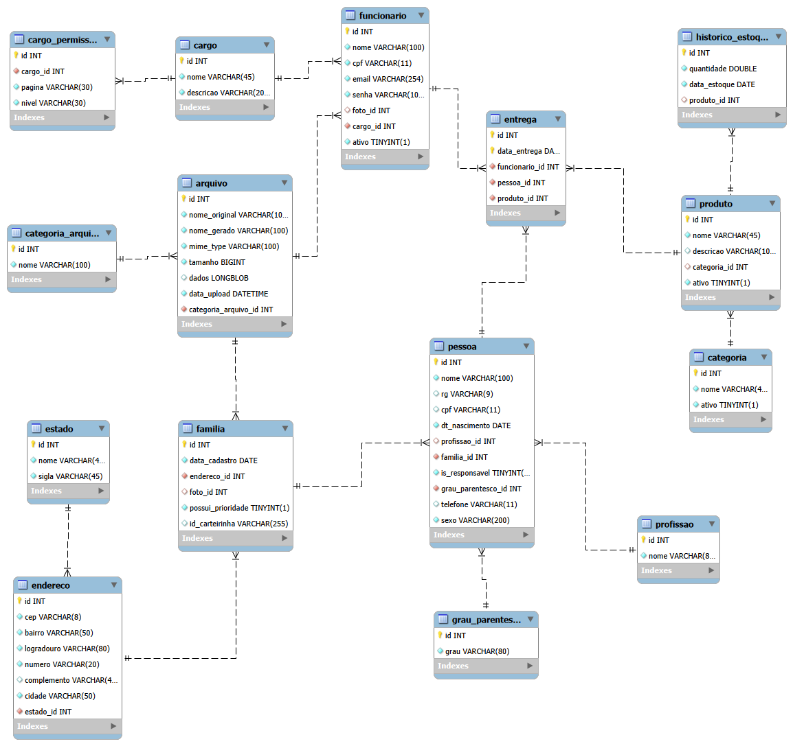

# 🗄️ Família Connect — Banco de Dados

> Script SQL de criação e população do banco de dados do sistema Família Connect, modelado para gerenciar doações de cestas básicas a famílias em situação de vulnerabilidade social.

---

## 📋 Sobre o Projeto

Este repositório contém o schema SQL do banco de dados **MySQL** utilizado pelo sistema Família Connect. O script `schema.sql` cria o banco `familia_connect`, define toda a estrutura relacional (tabelas, chaves e constraints) e o popula com dados de referência, um conjunto básico de exemplo e um bloco de dados de demonstração para o dashboard.

---

## 📁 Estrutura do Repositório

```
Familia-Connect-BD/
├── schema.sql     # Script completo: criação do banco, tabelas, constraints e dados iniciais
├── model.mwb      # Modelo visual do banco (MySQL Workbench)
├── model.mwb.bak  # Backup do modelo
├── model.png      # Diagrama entidade-relacionamento exportado do modelo
└── README.md
```

---

## 🗂️ Diagrama de Entidades

O banco de dados é composto por **15 tabelas**. O diagrama completo está em [`model.png`](model.png):



Resumo dos relacionamentos:

```
estado ──< endereco ──< familia ──< pessoa >── profissao
                           │           └──── >── grau_parentesco
                           └── foto ──> arquivo >── categoria_arquivo

cargo ──< cargo_permissao
  └────< funcionario ── foto ──> arquivo
              └──────< entrega >── pessoa
                          └─────── produto >── categoria
                                      └──< historico_estoque
```

---

## 📊 Tabelas

### Famílias e pessoas

| Tabela | Descrição |
|---|---|
| `familia` | Famílias beneficiárias: data de cadastro, endereço, foto (opcional), flag de prioridade (`possui_prioridade`) e identificador da carteirinha (`id_carteirinha`) |
| `pessoa` | Membros de cada família: dados pessoais, sexo, telefone, profissão, grau de parentesco e se é o responsável (`is_responsavel`) |
| `endereco` | Endereço da família: CEP, logradouro, número, complemento, bairro, cidade e estado |
| `estado` | Os 27 estados brasileiros, com sigla |
| `profissao` | Profissões pré-cadastradas para vínculo com as pessoas |
| `grau_parentesco` | Graus de parentesco usados em `pessoa` (ex.: `Pai/Mãe`, `Filho/Filha`) |

### Funcionários e permissões

| Tabela | Descrição |
|---|---|
| `funcionario` | Usuários do sistema: nome, CPF, e-mail, senha (hash bcrypt), foto opcional, cargo e flag `ativo` |
| `cargo` | Cargos dos funcionários (`Diretor`, `Recepcionista`) |
| `cargo_permissao` | Permissões de cada cargo: uma linha por par (`cargo_id`, `pagina`) com o `nivel` de acesso. Há uma constraint `UNIQUE` em (`cargo_id`, `pagina`) |

### Estoque e entregas

| Tabela | Descrição |
|---|---|
| `produto` | Produtos doados: nome, descrição, categoria e flag `ativo` |
| `categoria` | Categorias dos produtos, com flag `ativo` |
| `historico_estoque` | Registros de reposição de estoque: quantidade, data e produto |
| `entrega` | Entregas de produtos: **uma linha por item entregue**, vinculando funcionário, pessoa e produto, com a data da entrega |

### Arquivos

| Tabela | Descrição |
|---|---|
| `arquivo` | Arquivos enviados (fotos), com nome original, nome gerado, tipo MIME, tamanho, data de upload e o conteúdo binário em `dados` (`LONGBLOB`) |
| `categoria_arquivo` | Categoria do arquivo (`familias` ou `funcionarios`) |

---

## 🔑 Principais Relacionamentos

- Uma **família** possui um **endereço** e várias **pessoas**; opcionalmente tem uma foto (`arquivo`)
- Uma **pessoa** pertence a uma família, tem um **grau de parentesco** e, opcionalmente, uma **profissão**; uma delas é marcada como responsável (`is_responsavel`)
- Um **funcionário** pertence a um **cargo**, e o cargo define as **permissões** por página do sistema (`cargo_permissao`)
- Uma **entrega** liga um **funcionário**, uma **pessoa** e um **produto**
- Um **produto** pertence a uma **categoria** e tem um histórico de reposições em `historico_estoque`

### Convenções do modelo

- **Exclusão lógica:** `funcionario`, `produto` e `categoria` têm a coluna `ativo` (padrão `true`), usada para desativar registros sem apagá-los.
- **Valores só com dígitos:** `cpf` (11), `rg` (9), `telefone` (11) e `cep` (8) são armazenados **sem pontuação**. Quem grava nesses campos precisa remover máscaras — por exemplo, o serviço de OCR devolve CPF, RG e telefone já formatados (`123.456.789-00`).
- **`entrega` não tem coluna de quantidade:** cada item entregue é uma linha. A chave primária é composta (`id`, `data_entrega`).
- **`historico_estoque`** guarda reposições (entradas) por data; não há uma coluna de saldo atual.
- **Permissões:** `cargo_permissao.pagina` e `nivel` são textos livres (`varchar(30)`), sem tabela de domínio. Os valores válidos são definidos pela aplicação.

---

## 🌱 Dados Iniciais (Seed)

O script insere dados em dois blocos.

### Dados base

| Tabela | Registros | Conteúdo |
|---|---|---|
| `estado` | 27 | Todos os estados brasileiros |
| `cargo` | 2 | `Diretor` e `Recepcionista` |
| `cargo_permissao` | 8 | Cargo `Diretor` com nível `ADMINISTRADOR` nas páginas `FAMILIAS`, `FUNCIONARIOS`, `PRODUTOS`, `CARGOS`, `CATEGORIAS`, `HISTORICO_ENTREGAS`, `HISTORICO_ESTOQUE` e `DASHBOARD`. O `Recepcionista` **não** tem permissões cadastradas |
| `funcionario` | 2 | João Silva (Diretor) e Ana Souza (Recepcionista) |
| `profissao` | 30 | Profissões comuns |
| `grau_parentesco` | 8 | Pai/Mãe, Filho/Filha, Avô/Avó, Tio/Tia, Primo/Prima, Sobrinho/Sobrinha, Neto/Neta, Genro/Nora |
| `categoria_arquivo` | 2 | `familias` e `funcionarios` |
| `categoria` | 5 | Alimentos, Higiene Pessoal, Limpeza, Vestuário, Medicamentos |
| `produto` | 14 | Cesta Básica, óleo, arroz, feijão, itens de higiene, limpeza, vestuário e medicamentos |
| `endereco` | 5 | Endereços de exemplo em SP, RJ, MG, PR e BA |
| `familia` | 4 | Famílias de exemplo, 2 delas com prioridade |
| `pessoa` | 9 | Membros das 4 famílias de exemplo |
| `historico_estoque` | 10 | Reposições de exemplo (uma delas com a data de execução do script, via `CURDATE()`) |
| `entrega` | 10 | Entregas de exemplo entre fevereiro e abril de 2026 |

### Dados de demonstração para o dashboard

Um segundo bloco, dentro de uma transação (`START TRANSACTION` … `COMMIT`), cria dados fictícios para popular os gráficos do dashboard. Todos usam IDs a partir de **90001**, para não colidir com os dados reais:

| Tabela | Registros | Conteúdo |
|---|---|---|
| `funcionario` | 3 | Contas **desativadas** (`ativo = 0`) com hash de senha de mentira — não é possível fazer login com elas |
| `endereco` | 12 | Endereços fictícios na zona leste de São Paulo |
| `familia` | 12 | Cadastros de maio a outubro de 2026, 6 com prioridade, carteirinhas `DEMO-9000x` |
| `pessoa` | 12 | Um responsável por família, sem CPF, RG ou telefone |
| `historico_estoque` | 60 | Reposições mensais (maio a outubro de 2026) dos produtos 1 a 10 |
| `entrega` | 117 | Entregas distribuídas entre maio e outubro de 2026. As famílias 90011 e 90012 não têm entregas |

Totais após executar o script completo: **15 tabelas**, 16 famílias, 21 pessoas, 5 funcionários (2 ativos), 70 registros em `historico_estoque` e 127 entregas.

> 💡 Em produção, remova o bloco de demonstração (a partir do comentário `INSERTS PARA DEMONSTRAÇÃO DE DADOS NA DASHBOARD`) e, se quiser, os dados de exemplo de famílias, pessoas e entregas.

---

## ⚙️ Pré-requisitos

- [MySQL 8+](https://dev.mysql.com/downloads/)
- [MySQL Workbench](https://www.mysql.com/products/workbench/) *(opcional, para visualizar o modelo `.mwb`)*

---

## 🚀 Como Executar

### Opção A — Pelo terminal MySQL

```bash
mysql -u seu_usuario -p < schema.sql
```

### Opção B — Pelo MySQL Workbench

1. Abra o MySQL Workbench e conecte-se ao seu servidor
2. Vá em **File → Open SQL Script** e selecione `schema.sql`
3. Execute o script com `Ctrl+Shift+Enter` (ou botão ⚡)

### Opção C — Pela linha de comando dentro do MySQL

```sql
SOURCE /caminho/para/schema.sql;
```

> O script inclui `CREATE DATABASE IF NOT EXISTS familia_connect` e `USE familia_connect`, então o banco é criado automaticamente.

> ⚠️ **O script não é idempotente.** As tabelas são criadas com `CREATE TABLE` (sem `IF NOT EXISTS`) e não há `DROP`, então rodá-lo duas vezes no mesmo banco gera erro. Para recriar do zero, apague o banco antes:
>
> ```sql
> DROP DATABASE familia_connect;
> ```

> ℹ️ Ao final do bloco de produtos, o script executa um `SELECT * FROM produto;`, que apenas exibe a listagem no cliente. É inofensivo.

---

## 🔐 Funcionários Padrão

O script insere dois funcionários ativos para acesso ao sistema:

| Nome | CPF | E-mail | Cargo |
|---|---|---|---|
| João Silva | 52437201866 | joao.oliveiraneto@sptech.school | Diretor |
| Ana Souza | 24704891801 | anna.maegaki@sptech.school | Recepcionista |

As senhas são armazenadas como hash **bcrypt** (`$2a$10$...`); as senhas em texto puro não estão no repositório.

> ⚠️ **Atenção:** em ambiente de produção, troque as senhas desses usuários (ou remova-os e crie os seus) antes de expor o sistema.

---

## 🔎 Exemplos de Consultas

Estas consultas **não** fazem parte do `schema.sql`; são exemplos de uso sobre o schema.

**Listagem de famílias** (com responsável, telefone e prioridade):
```sql
SELECT f.id, p.nome, SUBSTRING_INDEX(p.nome, ' ', -1) AS nomeFamilia,
       p.telefone, f.possui_prioridade
FROM familia f
INNER JOIN pessoa p ON p.familia_id = f.id
WHERE p.is_responsavel = true;
```

**Membros de uma família** (responsável primeiro):
```sql
SELECT p.*, SUBSTRING_INDEX(p.nome, ' ', -1) AS nomeFamilia
FROM pessoa p
WHERE p.familia_id = 1
ORDER BY p.is_responsavel DESC;
```

**Famílias há mais tempo sem receber entrega** (as que nunca receberam aparecem primeiro):
```sql
SELECT f.id, MAX(e.data_entrega) AS ultima_entrega
FROM familia f
INNER JOIN pessoa p ON p.familia_id = f.id
LEFT JOIN entrega e ON e.pessoa_id = p.id
GROUP BY f.id
ORDER BY ultima_entrega ASC;
```

**Total reposto por produto:**
```sql
SELECT pr.nome, SUM(h.quantidade) AS total_reposto
FROM historico_estoque h
INNER JOIN produto pr ON pr.id = h.produto_id
GROUP BY pr.id, pr.nome
ORDER BY total_reposto DESC;
```

**Permissões de um cargo:**
```sql
SELECT c.nome AS cargo, cp.pagina, cp.nivel
FROM cargo c
INNER JOIN cargo_permissao cp ON cp.cargo_id = c.id
WHERE c.id = 1;
```

---

## 📄 Licença

Este projeto está sob a licença MIT. Consulte o arquivo [LICENSE](LICENSE) para mais detalhes.